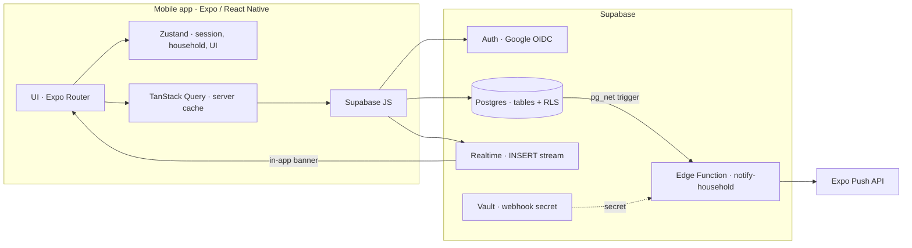
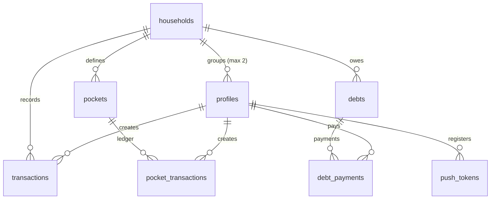
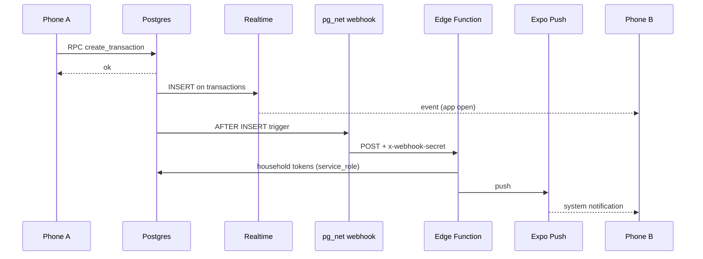

<div align="center">

# Hera

### Shared finances for two, without spreadsheets or crossed accounts.

An Android mobile app that lets a couple record income, expenses, savings and debts
in a single financial space, with consolidated calculations in real time.


</div>

---

## Screenshots

<div align="center">

<table>
  <tr>
    <td align="center" width="33%">
      <br />
      <sub><b>Summary</b><br />Money available for the period</sub>
    </td>
    <td align="center" width="33%">
      <br />
      <sub><b>Transactions</b><br />Shared history</sub>
    </td>
    <td align="center" width="33%">
      <br />
      <sub><b>Pockets</b><br />Savings goals with progress</sub>
    </td>
  </tr>
  <tr>
    <td align="center" width="33%">
      <br />
      <sub><b>To pay</b><br />Debts and payments</sub>
    </td>
    <td align="center" width="33%">
      <br />
      <sub><b>Members</b><br />Household, invite and alerts</sub>
    </td>
    <td align="center" width="33%"></td>
  </tr>
</table>

</div>

> The data in the screenshots is sample data (`ABC123` is a fictional code) and the
> profiles are anonymized.

---

## Table of contents

- [Screenshots](#screenshots)
- [What is Hera](#what-is-hera)
- [The problem and the proposal](#the-problem-and-the-proposal)
- [What the app does](#what-the-app-does)
- [Design decisions and why](#design-decisions-and-why)
- [Architecture](#architecture)
- [Tech stack and why](#tech-stack-and-why)
- [Data model](#data-model)
- [Security](#security)
- [Real-time and push notifications](#real-time-and-push-notifications)
- [Testing](#testing)
- [Project structure](#project-structure)
- [How to run it](#how-to-run-it)
- [Available scripts](#available-scripts)
- [Project status and next steps](#project-status-and-next-steps)
- [Documentation](#documentation)
- [License](#license)

---

## What is Hera

Hera is an Android app for managing a couple's money as if it were
a single household economy. Two people link through a **shared household**
and see exactly the same transactions, balances and savings goals.

This is not a clone of an expense-tracking app: it is designed around a specific
question: **how much money do we actually have free this month, after spending and
setting aside for our goals?**

To answer it, the system combines three pieces:

1. **Income and expenses** with category, date and description.
2. **Pockets** (savings goals) with their own balance and a ledger of contributions and withdrawals.
3. **Debts to pay** that, when paid off, become real household expenses.

The result is a dashboard that calculates:

```text
Available money = Accumulated income − Accumulated expenses − Balance of all pockets
Saved           = Sum of pocket balances
```

It is a simple subtraction on purpose. The hard part is not the formula: it is making it **correct
under concurrent writes**, impossible to manipulate from the client, and identical
on both phones.

**Current scope:** Android. The app is built with Expo, so the code is
compatible with iOS, but the native iOS configuration is not included yet.

---

## The problem and the proposal

### The real problem

Couples usually manage their finances in three ways, and all three fail:

- **Each one keeps their own separate account.** Nobody knows how much money there really is together.
- **A shared spreadsheet.** It gets out of date, cannot be checked quickly from a phone and validates nothing.
- **An individual expense-tracking app.** It models the user, not the couple: there is no concept of "our money", shared goals, or who made each transaction.

### The proposal

Model the **household** as a first-class entity:

- A `household` groups at most two profiles.
- Every financial record (transaction, pocket, debt) belongs to the household, not to the user.
- Access is enforced in the database with **Row Level Security**, not in the client.
- Operations that move money are **transactional RPCs** in PostgreSQL.

That last point is the most important decision in the project: the client can ask,
but never decide how much money there is.

---

## What the app does

### Authentication and household

- Sign-in with **native Google** (no WebView) and `signInWithIdToken` against Supabase Auth.
- Session persisted in the **Android Keystore** through `expo-secure-store`.
- Route guard: no session → login; session but no household → onboarding.
- Creating a household generates an **invite code**; the partner joins with that code.
- Hard limit of two members per household, enforced in the database.
- Sign-out revokes Google, removes the push token and clears global state.

### Dashboard

- **Available money** calculated on the server, not by summing arrays on the phone.
- Filter by **day, week and month** (weeks start on Monday, in local time).
- Donut chart of income vs. expenses for the period (`react-native-svg`).
- Summary cards with *skeleton loaders* while the aggregates load.
- Quick list of pockets and pending debts.
- Refresh via *pull-to-refresh*, on focus and through Realtime events.

### Transactions

- A single form for income and expenses.
- Validation with **Zod + React Hook Form** before submitting.
- Amounts are always positive: the sign is defined by `type` (`INCOME` / `EXPENSE`), not by a negative number.
- Chronological history with pagination and deletion via RPC.

### Pockets (savings goals)

- Create pockets with a name and an optional target.
- Add or withdraw money from a *bottom sheet*.
- **Denormalized balance** (`current_balance`) for fast reads + **ledger** (`pocket_transactions`) for auditing.
- Two business rules enforced on the server:
  - You cannot withdraw more than the pocket holds.
  - You cannot add more than the household has available.
- Validation happens inside the same SQL transaction, with a per-household *lock*,
  so two simultaneous contributions from different phones cannot spend the same money.

### Debts to pay

- Record debts with total amount, paid amount and an optional due date.
- Payments generate **two atomic writes**: a payment in the ledger and a real expense
  in `transactions`, so the dashboard reflects the money that actually left.
- A pending debt is informational: it does not reduce "available money" until it is paid.
- Overpayment validation with row locking (`FOR UPDATE`).

### Members and notifications

- Members screen with avatars, a copyable invite code and sign-out.
- Notifications card to request the system permission.
- **In-app banner** when the partner records a transaction (Supabase Realtime).
- **System push** when the app is closed or in the background (Expo Push).

---

## Design decisions and why

This section is the core of the project: not only *what* was used, but *why* and what was
rejected. Every decision has a technical consequence you can verify in the code.

| Decision | Rejected alternative | Criterion |
|---|---|---|
| **Supabase** as the backend (Postgres + Auth + Realtime + Edge Functions) | A custom backend in FastAPI/Node | The domain is relational and money demands transactions. Postgres provides real integrity; Supabase adds Auth, Realtime and functions without standing up infrastructure. For a two-person mobile product, operational simplicity matters more than flexibility. |
| **RLS + `SECURITY DEFINER` RPCs** | Validating permissions only in the app | The client is hostile territory. RLS guarantees per-household isolation even with a valid JWT and a tampered payload. Critical writes are never direct `INSERT`/`UPDATE`; they go through SQL functions. |
| **`numeric(12,2)`** for money | `float` / `double` | Floating point cannot represent cents exactly. Accumulated rounding in a ledger is a financial bug, not a detail. |
| **Ledger + cached balance** in pockets | A single overwritten `balance` field | The ledger makes every contribution and withdrawal auditable. The cached balance avoids summing the history on every read. It is updated by a trigger inside the same transaction. |
| **SQL aggregates** (`get_household_summary`) | Summing transactions in JavaScript | Downloading thousands of rows just to add them up does not scale on a phone. The server returns totals that are already calculated and consistent for every device. |
| **Feature-first** (`src/features/*`) | Folders by layer (components, services, stores) | Each domain (auth, dashboard, pockets, debts…) contains its API, hooks, schemas, components and tests. A domain can be understood, tested and deleted without walking through five folders. |
| **Spec-Driven Development** | Start coding and document later | Every phase has a document with goals, schema, security rules, acceptance criteria and testing strategy. Code is written against a contract, not a hunch. |
| **TanStack Query** for server data | Store everything in Zustand | Server state needs cache, invalidation, retries and refetch on focus. Zustand is reserved for truly global state (session, household, notifications). |
| **Zustand** for session/UI state | Context API or Redux | Minimal API, no nested providers and no boilerplate. The state is small and does not need Redux tooling. |
| **Zod + React Hook Form** | Manual validation in each form | A single schema defines the valid shape and is reused in tests. Validation happens before the network request, but the server validates again. |
| **Expo Router** with protected layouts | Hand-configured React Navigation | File-based routes, declarative guards and `(protected)`/`(tabs)` groups that mirror the app's real flow. |
| **`expo-secure-store`** | `AsyncStorage` | JWTs and refresh tokens are encrypted by the system Keystore/Keychain, not stored in plain text. |
| **Native Google Sign-In** | WebView OAuth | An embedded WebView is vulnerable to interception. The native flow returns an `idToken` that Supabase validates directly. |
| **Database webhooks + Edge Function** | The client sends the push | If the alert depends on the client, it never arrives when the app is closed. The `INSERT` in Postgres triggers `pg_net`, the function authenticates with a secret and looks up the other member's tokens using `service_role`. |
| **Component tests + SQL RLS tests** | Unit tests only | UI logic is tested with Jest/RNTL. Isolation rules are tested against real Postgres with SQL scripts, because RLS cannot be reliably simulated. |

### Accepted trade-offs

- **The client cannot write tables directly.** It is more verbose (every new operation
  requires an RPC and permissions), but it eliminates an entire class of payload-tampering
  attacks.
- **Business logic is duplicated on purpose** (Zod in the client, `CHECK`/`RAISE`
  in Postgres). Client validation is UX; server validation is the truth.
- **SQL aggregation couples the dashboard to Postgres.** This is accepted: it is exactly the
  engine that guarantees consistency and performance.
- **There is no full offline mode.** TanStack Query keeps a 30 s cache and refreshes on
  reconnect; an offline write queue is out of scope for now.

---

## Architecture



**Flow of a financial write:**

1. The UI validates with Zod and calls a TanStack Query hook.
2. The hook invokes an RPC (`create_transaction`, `add_pocket_transaction`, etc.).
3. Postgres enforces permissions with RLS, applies business rules and locks, then writes.
4. Triggers update balances and notify through Realtime and/or the webhook.
5. TanStack Query invalidates the affected queries and the dashboard recalculates from the server.

The client never computes the final balance and never writes to the tables directly.

---

## Tech stack and why

### Application

| Technology | Use | Why |
|---|---|---|
| **Expo SDK 57** | Toolchain, builds, OTA and native modules | Enables fast iteration on Android without maintaining a full native project; EAS produces reproducible APK/AAB files. |
| **React Native 0.86 + React 19** | Mobile UI | A single TypeScript codebase for the app, with access to native APIs (Keystore, notifications, Google Sign-In). |
| **Strict TypeScript** | All the code | In a financial app, a `string` that should be a `number` is a money bug. `strict: true` and types derived from schemas. |
| **Expo Router** | Navigation | File-based routes and per-layout guards; the protected flow is declared, not improvised. |
| **TanStack Query** | Server state | Cache, invalidation on focus/realtime and mutations with explicit loading/error states. |
| **Zustand** | Global state | Session, selected household and the in-app notification queue, without providers. |
| **Zod** | Validation | Declarative schemas reused by forms and tests. |
| **React Hook Form** | Forms | Performance and per-field error handling without re-rendering the whole form. |
| **react-native-svg** | Donut chart | Full control over drawing and design, without heavy chart dependencies. |
| **react-native-reanimated** | Animations | Smooth transitions and list entrances on the UI thread. |
| **expo-secure-store** | Session persistence | Native token encryption (Keystore/Keychain). |
| **expo-notifications** | System push | Integration with FCM/APNs and Expo token registration. |

### Backend

| Technology | Use | Why |
|---|---|---|
| **Supabase Postgres** | Relational database | Transactions, constraints, triggers, locks and SQL for aggregates. |
| **Supabase Auth** | Google login | Validates Google's `idToken` and issues JWTs; no need to implement OIDC. |
| **Row Level Security** | Per-household isolation | Security lives next to the data and applies to any client. |
| **Supabase Realtime** | In-app banner | `INSERT`s on `transactions` and `pocket_transactions` are published and reach the other phone. |
| **Edge Functions (Deno)** | `notify-household` | Receives the webhook, resolves the household's tokens and calls Expo Push. |
| **`pg_net` + Database Webhooks** | Push trigger | The alert originates from the `INSERT`, not from the client. |
| **Supabase Vault** | Webhook secret | The `WEBHOOK_SECRET` is neither versioned nor shipped to the client. |

### Quality

| Technology | Use | Why |
|---|---|---|
| **Jest + jest-expo** | Unit and component tests | Runs React Native code in Node with native module mocks. |
| **React Native Testing Library** | UI tests | Tests user-visible behavior, not implementation details. |
| **ESLint + Prettier** | Style and static errors | Consistent TypeScript rules and formatting; `prettier/prettier` as an error. |
| **`.gitattributes` (`eol=lf`)** | Line endings | Prevents `core.autocrlf` on Windows from breaking Prettier on every line. |
| **EAS Build** | APK/AAB | `development`, `preview` and `production` profiles. |

---

## Data model



| Table | Purpose | Key detail |
|---|---|---|
| `households` | Shared financial space | Unique `invite_code`; at most two profiles. |
| `profiles` | Extension of `auth.users` | Nullable `household_id` during onboarding; `handle_new_user` trigger. |
| `transactions` | Income and expenses | `amount numeric(12,2) > 0`; `type` defines the sign; `household_id` + `created_by`. |
| `pockets` | Savings goals | Cached `current_balance`; optional `target_amount`. |
| `pocket_transactions` | Pockets ledger | Positive `amount` = contribution, negative = withdrawal; balance trigger. |
| `debts` | Debts to pay | `total_amount`, `paid_amount`, `due_date`. |
| `debt_payments` | Payments ledger | Reference to the real expense created in `transactions`. |
| `push_tokens` | Expo tokens | No client access; only register/unregister RPCs. |

---

## Security

Security is not a layer added at the end: it lives in the data model.

### 1. Per-household isolation with RLS

All financial tables have `ROW LEVEL SECURITY` **and `FORCE ROW LEVEL SECURITY`**.
Policies compare the row's `household_id` with the authenticated user's household:

```sql
household_id = private.get_my_household_id()
```

Helper functions live in a `private` schema, are `SECURITY DEFINER` and pin
`search_path = ''` to prevent name-resolution attacks. The `private` schema
is not accessible from `anon`.

### 2. The client does not write tables

The `authenticated` role only has direct `SELECT`. Writes go through RPCs that:

- verify `auth.uid()`;
- verify household membership;
- enforce business rules (`INSUFFICIENT_AVAILABLE_FUNDS`, `DEBT_PAYMENT_EXCEEDS_PENDING`, etc.);
- run inside a transaction with locks when there is concurrency.

An attacker who knows someone else's UUID still sees zero rows: the policy is applied
before any data is returned.


---

## Real-time and push notifications

There are two channels with the same origin: an `INSERT` in Postgres.



### App open

`useHouseholdActivity` subscribes to `INSERT`s on `transactions` and
`pocket_transactions` for the household. When the event was created by **the other member**:

- invalidates the transactions, dashboard, pockets and available queries;
- shows an in-app banner with the actor's name and the amount;
- ignores events older than 60 s so it does not present as "new" something that arrived on reconnect.

### App closed or in the background

1. The migration creates `AFTER INSERT` triggers that call the Edge Function with `pg_net`.
2. `notify-household` validates the secret header.
3. It resolves the household tokens, excluding the author of the transaction.
4. It sends the push through the Expo API in batches of up to 100.

If the webhook fails, **the transaction is still saved**: the alert is *best-effort* and never
blocks the financial operation.


---

## Testing

The strategy combines fast UI tests with real security tests against the database.

| Type | Tool | What it covers |
|---|---|---|
| Unit | Jest | Money utilities, periods, Zod schemas, stores, services with mocks. |
| Components | React Native Testing Library | Forms, dashboard, pockets, debts, members, protected navigation. |
| RLS contract | Jest (mocks) | A household sees its rows; an intruder sees zero; a direct `INSERT` returns `42501`. |
| Real RLS | SQL scripts + `psql` | Isolation, permissions and business rules against Postgres. |
| Typecheck | `tsc --noEmit` | TypeScript contracts across the project. |
| Lint | ESLint + Prettier | Static errors and formatting. |


Each script runs in a transaction, creates test users, attempts to access someone else's
data and ends with an assertion `SUMMARY`. The final `ROLLBACK` leaves the database untouched.

---

## Project structure

```text
.
├── src/
│   ├── app/                  # Expo Router routes (login, setup, protected tabs)
│   ├── core/                 # Supabase client, query client, constants, navigation
│   ├── features/
│   │   ├── auth/             # Google Sign-In, session store, guard
│   │   ├── dashboard/        # Aggregates, periods, chart, balance
│   │   ├── transactions/     # Form, history, schemas, service
│   │   ├── pockets/          # Pockets, bottom sheet, available to contribute
│   │   ├── debts/            # Debts, payments, ledger
│   │   ├── household/        # Household, invitation, members
│   │   └── notifications/    # Realtime, push, in-app banner
│   ├── shared/               # Reusable UI components, hooks and utilities
│   └── test-utils/           # Testing helpers
├── supabase/
│   ├── migrations/           # 13 versioned migrations
│   ├── functions/            # notify-household Edge Function
│   ├── tests/                # RLS and hardening audits
│   └── config.toml
├── docs/
│   ├── specs/                # PRD, user flow, plan and 7 phase specs
│   ├── ui/                   # UI/UX design guide
│   └── screenshots/          # Screenshots of the main screens
├── assets/
├── .gitattributes
├── app.json
├── eas.json
└── package.json
```

### Conventions

- **One feature = one folder.** Each domain exposes its API, hooks, schemas, components and tests.
- **The UI does not talk to Supabase.** Components call hooks; hooks call services; services call RPCs.
- **Types live next to their schema.** Zod is the source of truth for forms.
- **Error names are domain-level**, not Postgres-level.

---

## Project status and next steps

### Implemented

- Google authentication and encrypted session.
- Shared household with invite code and a two-member limit.
- Income and expense transactions with history.
- Pockets with a ledger, cached balance and concurrency rules.
- Debts with payments that generate real expenses.
- Dashboard with periods, chart and SQL aggregates.
- In-app notifications via Realtime and push via webhook.
- UI with skeletons, animations and shared components.
- 53 suites / 284 tests, typecheck and lint passing.


### Known limitations

- Only Android is configured at the native level.
- Remote push requires a development build.
- No offline write support (read cache only).
- The RLS scripts run manually; they are not automated in CI yet.

---

## Documentation

The project was built with **Spec-Driven Development**: contract first, code second.

Each spec defines goals, data schema, security policies, testing strategy and
*Definition of Done*. The decisions in this README can be traced back to
those documents.

---

## License

MIT © 2026 Juan José Correa Galarza. See [`LICENSE`](LICENSE).

---

<div align="center">

Made with TypeScript, PostgreSQL and the belief that shared money
should be easy to understand.

</div>
